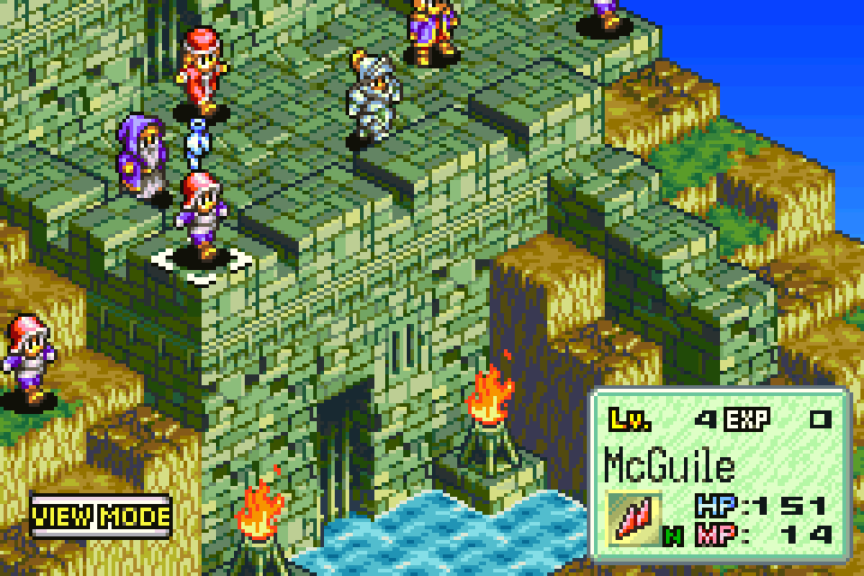
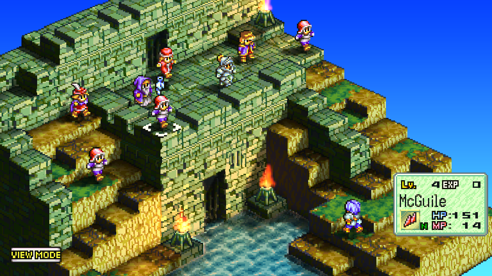
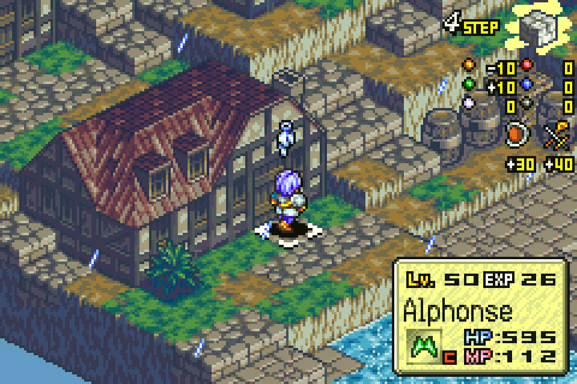
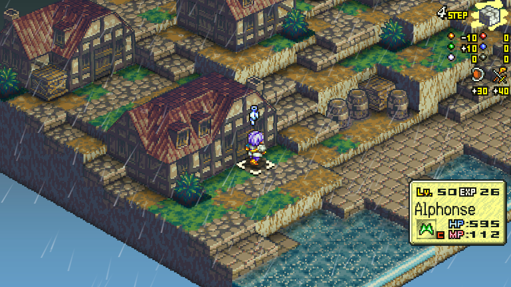
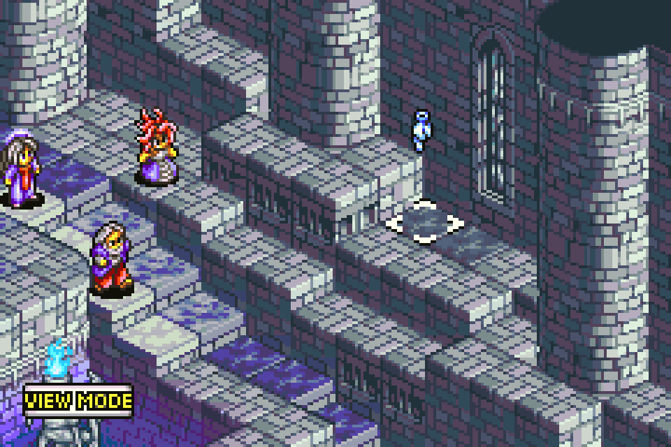
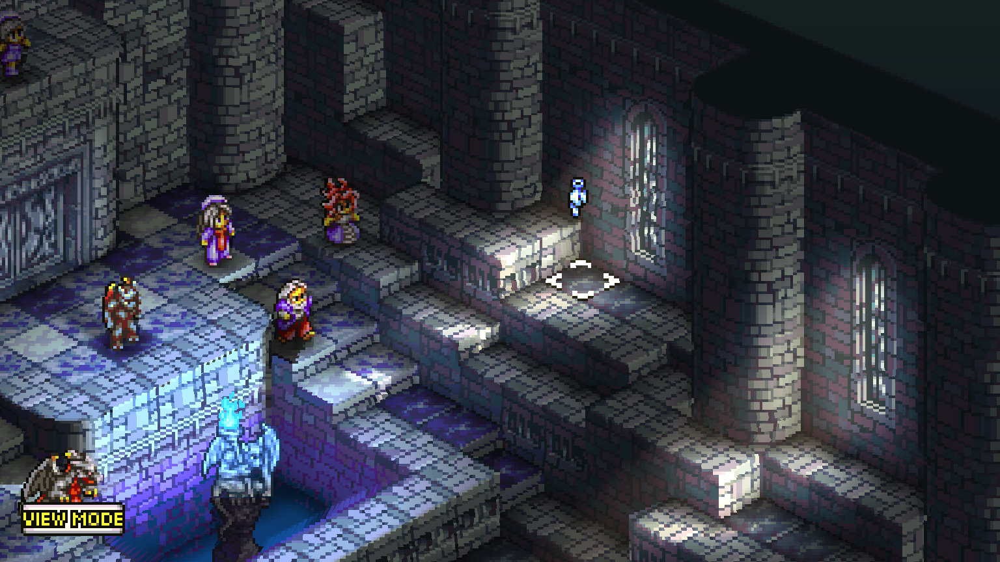
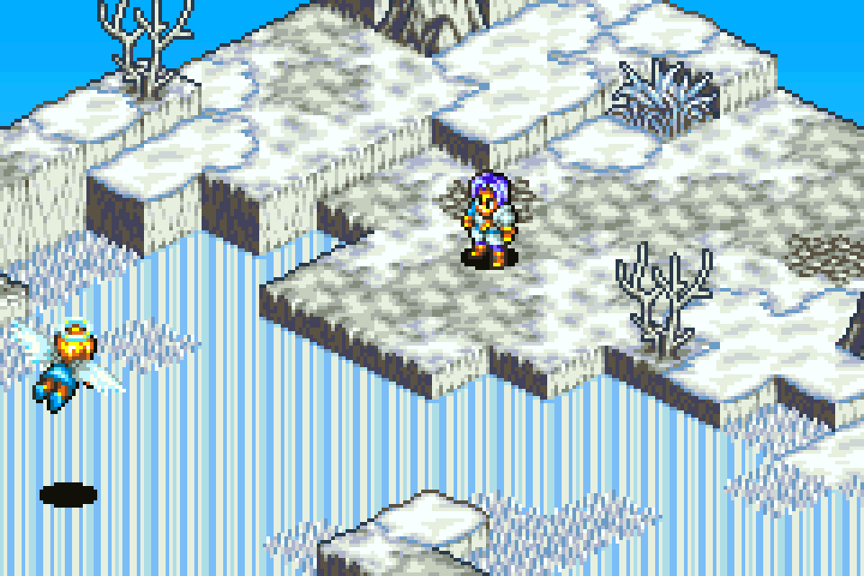
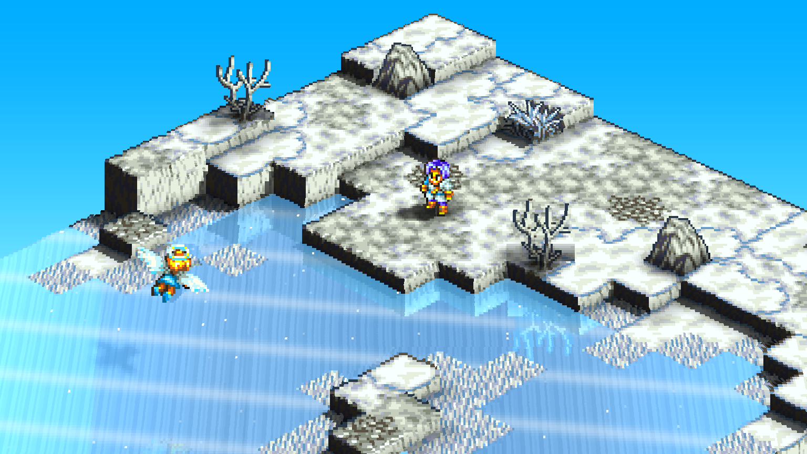
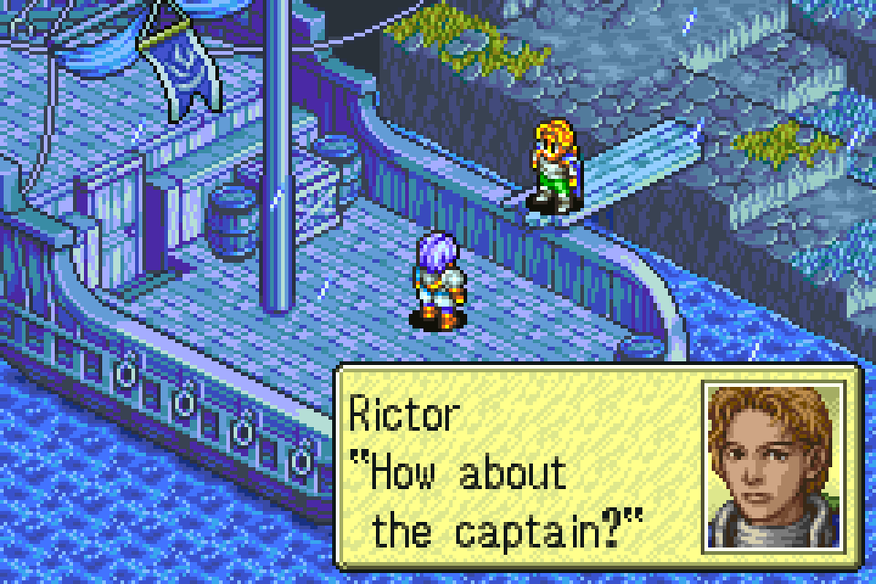
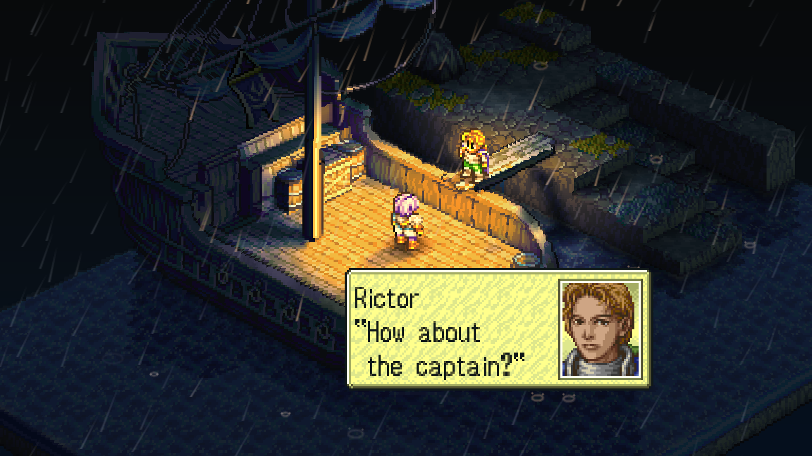

# Knight of Lodis Recomp

A native port of **Tactics Ogre: The Knight of Lodis** (Game Boy Advance, USA,
game code `ATOE`) and of its Japanese version, **Tactics Ogre Gaiden: The
Knight of Lodis** (`ATOJ`), for Android and desktop, built on
[gbarecomp](https://github.com/mstan/gbarecomp): the game's code is statically
recompiled to C++ and runs natively, with the real GBA hardware behaviour
underneath and a set of optional enhancements on top.

This project does **not** include the game. You need your own legally obtained
copy of the cartridge ROM, of either version or both (and, optionally, the GBA
BIOS). Nothing copyrighted by Nintendo, Quest or Square Enix is distributed
here.

## Screenshots

The same moments with the **Original** preset (left) and the **Enhanced**
preset (right), at the same scale.

<p>
  
  
</p>
<p>
  
  
</p>
<p>
  
  
</p>
<p>
  
  
</p>
<p>
  
  
</p>

## Features

Everything below is optional; the **Original** preset plays the game as it was.

- **Widescreen in your screen's shape**: the battlefield, towns and scenes
  extended past the GBA's 240x160, in 16:9, 16:10, 3:2, 4:3 or 1:1 (Options >
  Enhancement Options > Display > Ratio; the screen's own shape by default), up to 480x270.
- **A 3D-feeling battlefield**: perspective that follows the camera (right
  stick, or a finger drag on touch screens), lighting with shadows, ambient
  occlusion, torchlight, window light and night scenes, water and ice
  reflections, rain and snow of its own, plants that sway, props that stand off
  the ground, depth of field.
- **Second screen** (dual-screen handhelds such as the AYN Thor): the unit's
  status sheet, the army list, HELP text and the options menu.
- **Sound**: a high-quality re-render of the game's music engine, stereo, and
  optional HD instruments.
- **VS Mode and Exchange without a link cable**: Quest Mode's VS battle
  against the computer, which fields a copy of your own army and plays it with
  the game's own AI, or VS and Exchange with another player over your local
  network, between any of the platforms below (**Options > Enhancement
  Options > Gameplay > VS Mode**: Computer or Network).
- **Shaders and scaling**: RetroArch's GLSL shader presets (CRT looks,
  scanlines, smoothing; the menu downloads RetroArch's collection, or add your
  own), with a separate one for the second screen on Android; Integer, Smooth
  or Stretch scaling; on computers, a window or full screen.
- **Quality of life**: fast loading, faster walking, actions and enemy turns,
  numbered save states, an analog cursor, rumble, Swap Face Buttons, and an
  options menu that pauses the game while you try settings.
- **Cheats** (off by default): Rewind, Shop Anywhere, No Random Battles.
- **Mods**: IPS, UPS or BPS patches made for the game that change its data
  (text, stats, graphics) can be played over your ROM, chosen at setup or from
  the options menu.
- **The Japanese version**: the game, and what the second screen shows from it
  (the unit sheet, equipment, talents, help texts), are in Japanese; the 3D
  battlefield and its lighting work as in the USA version.
- **RetroAchievements** (softcore, USA version: the set is made for it).
- **On-screen controls** on phones when no controller is connected.

## What you need

- Your own ROM of either version, or both. It can be named anything:
  - `Tactics Ogre: The Knight of Lodis (USA)`
    (SHA-1 `85a46320a31f16f5c6dda27fc094edd078dbe43d`);
  - `Tactics Ogre Gaiden: The Knight of Lodis (Japan)`
    (SHA-1 `ec257d645c601e439f1ab34d9b598c0443aec3da`).
- Optionally the GBA BIOS (SHA-1 `300c20df6731a33952ded8c436f7f186d25d3492`).
  Without it, a built-in HLE BIOS is used, which is less tested.

The setup screen tells the two ROMs apart by itself. With both in place, a
button on it switches between them; from the game, **Options > Enhancement
Options > Technical > Game** goes back to it. Each version has its own save,
save states and mod: a save from one does not carry over to the other.

## Playing on Android

Install the APK. On first start, the setup screen asks for the ROM, and
optionally the BIOS and a mod; press **Play**. BACK (or the second screen's
button) opens the options menu.

Your save and save states are in Android's **Files** app, under the location
**Knight of Lodis**: `totkol.sav` is the game's save, and the folder `states`
holds the save states of the Save States page, three files each
(`0007.state`, its picture `0007.png` and its details `0007.txt`). Copy them
out to back them up, or copy them in to use them (a file that is replaced is
kept as `<name>.bak`). Replace the save with the game closed: it is read at
start. A state copied in shows on the Save States page after a restart. A mod
has its own save and its own states folder, each named with the mod's code
(`totkol-1a2b3c4d.sav`, `states-1a2b3c4d`). The Japanese version's save and
states are in the folder `japan` there, laid out the same way.

**Sync Folder:** choose a folder in **Options > Enhancement Options >
Technical > Sync Folder**, and the game copies your save, save states and logs there
whenever they change: a backup, a way to move your game to another device, or
the logs for a bug report. The Japanese version's go in a `japan` folder
inside it. If the folder already has saves from the game, it asks which set to
keep, and moves the other to a `backup-<date>` folder inside it.

## Playing on Linux, the Steam Deck, macOS and Windows

- **Linux and Steam Deck:** download `KnightOfLodisRecomp-<version>-x86_64.AppImage`,
  mark it executable and run it. On the Deck, add it to Steam (Games > Add a
  Non-Steam Game) to play from Gaming Mode. It needs glibc 2.40 or newer
  (SteamOS 3.7, Fedora 41, Ubuntu 25.04, Debian 13; not Ubuntu 24.04).
- **macOS** (Apple Silicon, macOS 15 or newer): unzip and open **Knight of
  Lodis Recomp.app**. The first time, macOS blocks it: open System Settings >
  Privacy & Security and choose **Open Anyway**.
- **Windows** (64-bit, Windows 10 or newer): unzip and run
  `KnightOfLodisRecomp.exe` from its folder. Windows may warn that the program
  is from an unknown publisher: choose **More info**, then **Run anyway**.

On first start a setup window asks for the ROM, and optionally the BIOS and a
mod: click a box, or drag the file onto the window. A click of the right stick
or **Esc** opens the options menu; its last row quits the game. To log in to
RetroAchievements, open **Options > Achievements > Account** and type your
name and password (on the Steam Deck, **Steam + X** shows Steam's keyboard).

The game's files are in `~/.local/share/KnightOfLodisRecomp` (Linux),
`~/Library/Application Support/KnightOfLodisRecomp` (macOS) or
`%APPDATA%\KnightOfLodisRecomp` (Windows): the ROM copy, the save, the settings
and the `states` folder. The Japanese version's ROM, save and states are in a
`japan` folder inside it; the settings are shared. To choose another ROM or
switch version, use **Options > Enhancement Options > Technical > Game**; to
choose or remove a mod, **Options > Enhancement Options > Mod** (where no file
dialog can open, as in the Steam Deck's Gaming Mode, it takes you to the setup
screen instead).

**VS and Exchange over the network on Windows:** the first time the game looks
for another player, Windows Firewall asks whether it may use the network.
Allow it on private networks.

**Logs, for a bug report:** each run writes `logs/last_run.log` in that folder
(the run before is kept as `previous_run.log`). If the game crashes, a report
is added to it, and the next start says so. **Options > Technical > Logs**
opens the folder. On Android the Files app shows a `logs` folder under
*Knight of Lodis Recomp*. Send `previous_run.log` after a crash, or both.

**Keyboard** (when no controller is connected):

| Key | | Key | |
|---|---|---|---|
| Arrows | D-pad | Q / E | L / R |
| X | A | Return | Start |
| Z | B | Right Shift | Select |
| S | Next unit (the pad's north button) | A | Previous unit (west button) |
| Esc or F10 | Options menu | `` ` `` (left of 1) | Rewind (when the Rewind cheat is on) |
| 2, or Tab held | Fast-forward | Alt+Return | Full screen |
| Shift+F1 or F5 | Save a state | F1 or F6 | Load the latest state |

To change them, put a `keybinds.ini` in the game's folder:

```ini
[player1]
a = X
b = Z
select = Right Shift
start = Return
up = Up
down = Down
left = Left
right = Right
l = Q
r = E
```

## Building

Requires a sibling checkout of [gbarecomp](https://github.com/mstan/gbarecomp),
built once per its own README, and your ROM as `totkol.gba` at the root of this
directory.

```sh
# 1. Generate the recompiled game code from the ROM and game.toml
../gbarecomp/build/gba_recompile --rom totkol.gba --config game.toml --out generated

# 2. The HD instruments' sound bank (optional; needs the FluidR3 soundfont)
tools/hd_audio/get_soundfont.sh
python3 tools/hd_audio/build_bank.py --atten-factor 1.0

# 3a. Desktop (needs SDL2, and libcurl except on Windows)
cmake -S . -B build -G Ninja
cmake --build build --target KnightOfLodisRecomp
./build/KnightOfLodisRecomp --rom totkol.gba --bios path/to/gba_bios.bin

# 3b. Android (NDK r27, JDK 17; SDL2 2.32.10 unpacked at android/app/jni/SDL)
cd android && ./gradlew assembleRelease   # -> app/build/outputs/apk/release/KnightOfLodisRecomp.apk
```

The desktop downloads are made by `tools/package_appimage.sh` (built on a Steam
Deck over SSH, in the freedesktop SDK), `tools/package_macos.sh` and
`tools/package_windows.sh` (cross-compiled on a Mac with MinGW-w64; it builds
SDL2 from its pinned source). Each script's header says what it needs.

**The Japanese version** is a second program built from the same source:
`cmake -DKOL_REGION=ATOJ` makes `KnightOfLodisRecomp-jp` from the Japanese
ROM's own recompiled code in `generated_atoj/`, and the Android build adds
`libmain_jp.so` beside `libmain.so` when that folder exists. A package holds
both programs side by side; the one started hands over to the other when the
setup screen chooses the other version. How one source serves both ROMs is in
[docs/REGIONS.md](docs/REGIONS.md). The recompiler configuration for the
Japanese ROM is not published yet, so for now `generated_atoj/` cannot be
made from this repository alone.

`generated/` is never committed and must be regenerated whenever `game.toml`
changes. The release build leaves out the developer tools
(`-DKOL_DEV_TOOLS=OFF`; `tools/check_release_build.sh` checks it). A release is
signed with a key that is not part of this repository.

## Documentation

- [docs/DEVLOG.md](docs/DEVLOG.md): the full development log: how each feature
  works, its measurements, its switches and the approaches that failed. Code
  comments that cite a README section refer to this file.
- [docs/REGIONS.md](docs/REGIONS.md): the Japanese version: how game
  addresses are written once and placed for either ROM, the Japanese game's
  text format, and how one package holds a program for each version.
- `game.toml`: every hand-added recompiler entry, with the evidence for it.
- gbarecomp's own documentation for the framework and its tools.

## License

Knight of Lodis Recomp is licensed under the **PolyForm Noncommercial License
1.0.0** ([LICENSE](LICENSE)), as gbarecomp and its other game projects are:
free to use, change and share for any noncommercial purpose, not for sale or
other commercial use.

gbarecomp has its own license. The third-party notices the game ships with
(Options > Enhancement Options > Licenses in the game) are generated by `tools/make_licenses.py`:
`android/app/src/main/assets/licenses.txt` for Android and
`third_party/NOTICES-desktop.txt` for the desktop builds, which adds the
libraries each desktop package carries (their licence texts are in
`third_party/licenses/`).

Tactics Ogre: The Knight of Lodis, its ROM, the Game Boy Advance BIOS and all
game assets remain the property of their respective owners and are not
distributed by this project.

## Credits

- [gbarecomp](https://github.com/mstan/gbarecomp) by Matthew Stan, and the
  projects it credits.
- [SDL](https://www.libsdl.org), [rcheevos](https://github.com/RetroAchievements/rcheevos),
  [stb](https://github.com/nothings/stb), and the FluidR3 GM soundfont
  (Frank Wen, Toby Smithe).
